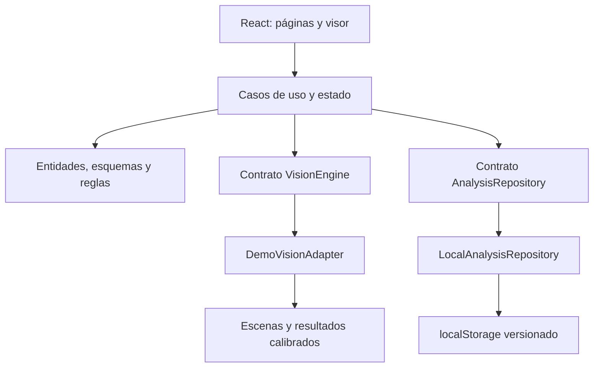

# Arquitectura y alcance

## Flujo implementado

La interfaz consume el motor a través de `VisionEngine`. Las operaciones de análisis, revisión y configuración se concentran en `core/application/operations.ts`. Las entidades y esquemas de validación residen en `core/domain/model.ts` y no dependen de React.

`AppProvider` coordina sesión, progreso, persistencia, notificaciones y estado compartido. Cada escritura se valida y se persiste antes de publicarse en la interfaz. Si falla, se conserva el estado anterior y se informa el error. La sesión demostrativa permanece en `sessionStorage`; los registros usan `localStorage`.

La navegación usa rutas hash para funcionar en servidores estáticos sin reglas de redirección. La compilación utiliza rutas de recursos relativas. `server.allowedHosts` habilita exclusivamente el host de la vista de desarrollo del entorno de trabajo, además de los hosts locales admitidos por Vite.

## Contratos y semántica

| Dato            | Regla                                                                                               |
| --------------- | --------------------------------------------------------------------------------------------------- |
| Confianza       | Valor 0–1; porcentaje en pantalla.                                                                  |
| Cajas           | X, Y, ancho y alto normalizados; no exceden los límites de la imagen.                               |
| Máscaras        | Polígonos normalizados y área calculada con la fórmula del polígono. No son segmentación aprendida. |
| Resultado bruto | Se conserva completo, incluso por debajo del umbral.                                                |
| Alerta          | Referencia análisis y regla; severidad, evidencia, responsable, nota y fechas.                      |
| Identificador   | UUID v4, con alternativa `getRandomValues` para desarrollo HTTP.                                    |
| Duración        | Valor fijo de ejemplo por escenario; no mide el rendimiento de un modelo.                           |
| Datos semilla   | 16 análisis relativos a la fecha de apertura, identificados con `seeded: true`.                     |
| Persistencia    | Esquema versión 1 validado con Zod; trabajos interrumpidos se cargan como fallidos.                 |

Los umbrales y clases filtran la vista; las reglas consideran la confianza original y la de configuración. Cambiar reglas no recalcula las alertas existentes. El dashboard deriva sus KPI desde los registros completados; sus cantidades de detecciones son brutas y pueden superar las visibles en un visor filtrado.

Los escenarios y máscaras tienen recursos SVG propios. Para añadir una escena se debe incorporar una ilustración, calibrar las coordenadas en `scenarios.ts`, configurar sus clases/patrones y añadir pruebas. El editor de escenas actual solo cambia metadatos y disponibilidad.

## Privacidad y límites técnicos

- Las imágenes propias se convierten en URLs de objeto para la vista actual. Se revocan al cambiar de archivo o salir del módulo. No se serializan en el repositorio.
- React escapa los nombres de archivo y las observaciones. El CSV escapa comillas y neutraliza prefijos de fórmulas.
- Los permisos son una restricción de flujo en cliente, nunca una frontera de seguridad. No se deben usar con información sensible real.
- No hay backend, control de concurrencia entre pestañas, almacenamiento remoto, auditoría inmutable ni telemetría.
- El registro local retiene hasta 500 eventos. El historial de análisis depende de la cuota de almacenamiento del navegador.
- Se preservan los datos corruptos al detectar un fallo de lectura; restablecer la demo es una acción explícita del administrador.
- Las fuentes tipográficas pueden descargarse de Google Fonts. Si no están disponibles, se usan fuentes del sistema; las escenas permanecen locales.

## Segunda fase: IA real

El directorio `server/` contiene exclusivamente el plan de integración. No se expone un interruptor REAL porque aún no hay un servicio operativo.

La evolución requiere:

1. Backend FastAPI con autenticación, validación de archivos y autorización real por usuario/empresa.
2. Ampliar el contrato de entrada para transportar archivos o referencias de almacenamiento autorizadas.
3. Implementar un adaptador API que cumpla `VisionEngine`, valide las respuestas y gestione errores/progreso.
4. Integrar detector/segmentador y preprocesamiento con datos de evaluación representativos.
5. Medir precisión, recall, IoU, mAP y latencia; no reutilizar las cifras DEMO.
6. Introducir PostgreSQL, almacenamiento de objetos, retención y registros de auditoría de servidor.
7. Probar aislamiento, límites de recursos, solicitudes simultáneas y recuperación de trabajos.

El uso productivo no se considera completado por el hecho de sustituir un adaptador.
